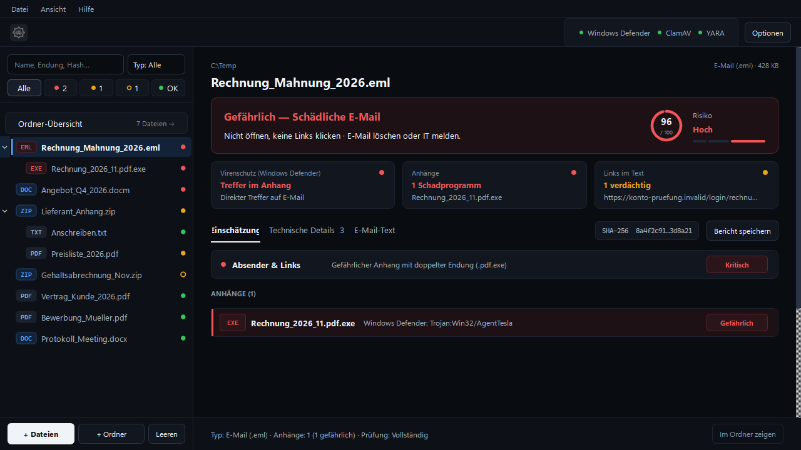
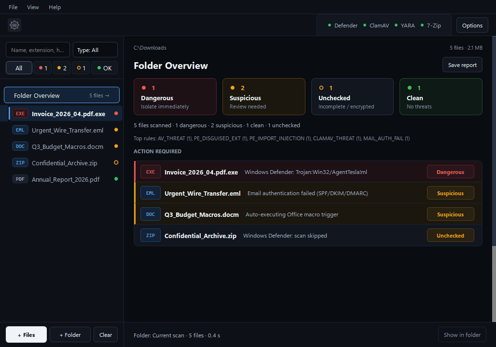
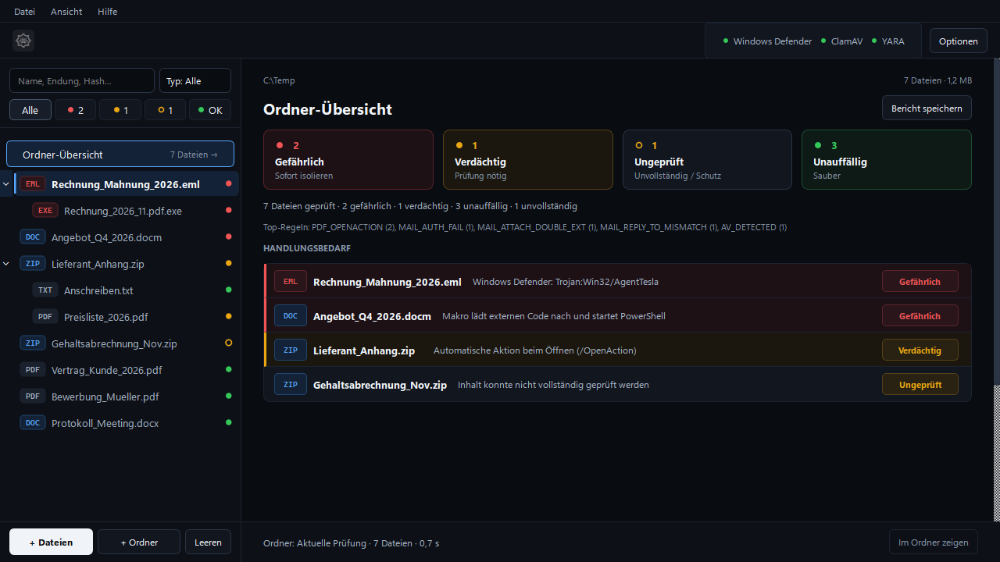
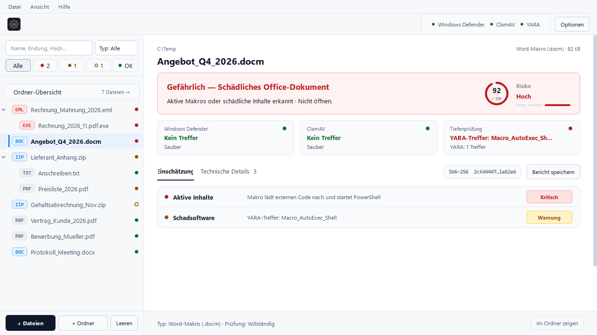
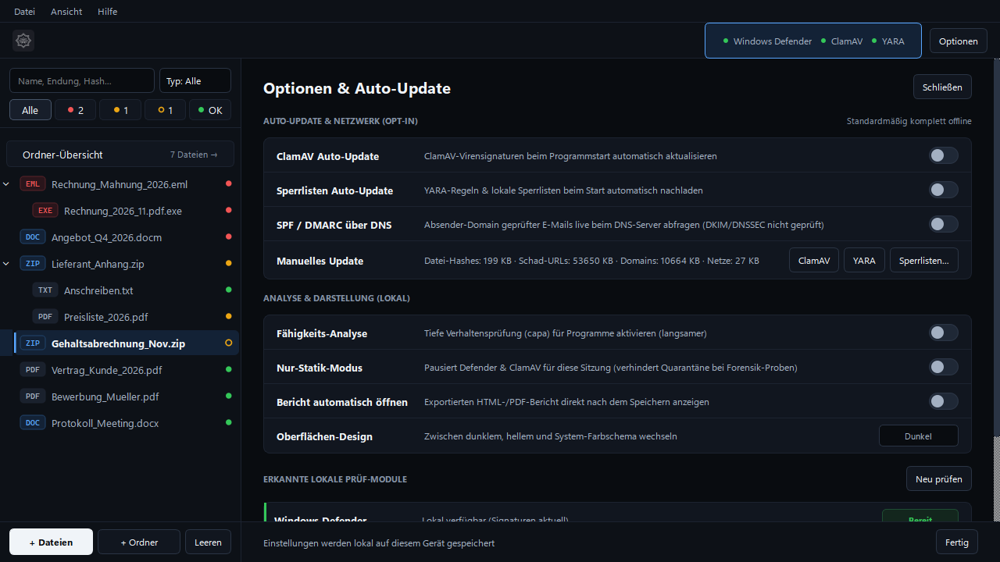

# Malaz

**100% local, offline-by-default** desktop file security triage for Windows 10/11. Malaz inspects suspicious documents, emails, archives, executables, scripts, and images directly on your own PC — **zero cloud uploads, zero telemetry, zero accounts**, and full source availability under **[GPL-3.0-or-later](LICENSE)** (third-party notices and SBOM in [THIRD_PARTY_NOTICES.md](THIRD_PARTY_NOTICES.md)).

<br clear="left" />

> **Your files never leave your computer (GDPR / Privacy by Design):** Invoices, HR applications, contracts, and customer emails often contain sensitive personal or confidential business data. Uploading them to public online virus scanners exposes file contents to third-party servers. Malaz analyzes everything locally on your machine — network access never occurs during standard scans, and optional signature/feed updates or DNS checks run **only** when explicitly enabled by the user ([docs/SECURITY_MODEL.md](docs/SECURITY_MODEL.md)).



> **UI Language Note:** In `v1.1.0`, the desktop GUI ("Klare Fläche v2" with Dark, Light, and System themes) and generated HTML/PDF triage reports use German labels and plain-language explanations; English UI localization is planned for an upcoming release. All CLI flags, JSON/CSV schema keys, source code, and repository documentation are in English.

---

## See Malaz in Action (`v1.1.0`)



| Folder Overview & Action List | Light Theme (Dark / Light / System) | Offline-by-Default Options |
| :---: | :---: | :---: |
|  |  |  |
| *Batch summary with 4 clear status KPIs (`Gefährlich`, `Verdächtig`, `Ungeprüft`, `Unauffällig`)* | *Token-driven Light & Dark themes with automatic High-DPI & screen scaling* | *Every network feature is opt-in and OFF by default (`Standardmäßig komplett offline`)* |

---

## Why Malaz?

When a suspicious invoice, job application, USB file, or email attachment lands on your desk, you usually face an uncomfortable trade-off:

1. **Upload it to an online scanner** — risking a **GDPR / confidentiality breach** because confidential documents leave your control and may be stored or shared with third parties.
2. **Rely on a single silent antivirus check** — which often misses brand-new phishing links, disguised `.pdf.exe` attachments, malicious Office macros, or quietly skips password-protected archives without warning you.

**Malaz closes this gap locally:** it combines **format-aware static inspection** with **local multi-engine scanning** (Windows Defender, ClamAV, and YARA) in one portable Windows app, and translates technical indicators into plain-language traffic-light verdicts (`GREEN` / `YELLOW` / `RED` — plus an explicit `UNCHECKED` state whenever anything could not be inspected).

## Key Capabilities

- **Format-Specific Static Pipelines:**
  - **PDF:** Keyword triage, `pikepdf`/qpdf object & stream inspection, structural action-graph traversal (`/OpenAction`, `/AA`, `/Launch`), bounded static JavaScript deobfuscation (`PDF_JS_DEOBFUSCATED`), and invisible/color-on-color layout forensics.
  - **Office & OLE/OOXML:** VBA macro & auto-exec triage, VBA stomping (`pcodedmp`), hex/Base64 string decoding, DDE links, Excel 4.0 (`XLM`) macro emulation, `.xlsx` formula scanning, and remote template injection (`OFFICE_REMOTE_TEMPLATE`).
  - **Email (`.eml` / `.msg`):** Header authentication analysis, display-name & reply-to spoofing heuristics, defanged link extraction, safe plain-text mail viewer, and recursive attachment scanning.
  - **Executables (`PE` / `ELF` / `Mach-O`):** Header/section anomalies, RWX sections, overlays, Authenticode metadata, suspicious imports/strings, plus optional local **Detect It Easy** (`diec.exe`) and **capa** integration.
  - **Images & Media:** Magic-byte vs. extension mismatch (`GEN_FORMAT_MISMATCH`), appended payloads past PNG `IEND` / JPEG `EOI`, HEIC/AVIF box bounds, and EXIF inspection.
  - **Archives & Containers:** Recursive bounded inspection of `ZIP`, `TAR`/`GZIP`/`BZIP2`/`XZ`, and (via local 7-Zip CLI) `7z`, `RAR`, `CAB`, and `ISO`, hardened against Zip-Slip, junctions, and decompression bombs.
  - **Generic & Scripts:** Vectorized Shannon entropy, bundled YARA rules (`rules/yara/malaz_*.yar`), local SHA-256/URL/domain/CIDR blocklists, `.lnk` shortcut target/argument parsing, `.rtf`, and `.swf`.
- **Multi-Engine Local Orchestration:** Runs on-demand **Windows Defender** (`MpCmdRun.exe`), **ClamAV** (`clamdscan` / `clamscan`), and **YARA** side by side with per-engine status cards (`clean` / `threat` / `unchecked`).
- **Completeness Invariant (*"Unchecked is Never Clean"*):** Missing parsers, skipped stages, password-protected archives, size caps, or timeouts never silently pass as `GREEN`; incomplete inspections surface explicitly in the verdict badge, folder overview, detail pane, CLI exit code, and exported reports.
- **Large Files up to 2 GB:** Files up to 64 MB are buffered in memory; files between 64 MB and 2 GB stream in 8 MB chunks for SHA-256, entropy, YARA, and raw-byte IOCs while passing file paths to ZIP/PDF/AV stages and an 8 MB prefix to deep parsers.
- **Self-Contained Reports:** Exports standalone HTML5 and PDF reports (zero JavaScript, zero external requests, strict HTML/CSV/Bidi sanitization) plus JSON and CSV batch summaries.

---

## Quickstart

### Option 1: Portable Standalone Release (No Python Required)

1. Download `Malaz-1.1.0.zip`, `SHA256SUMS-1.1.0.txt`, `SHA256SUMS-1.1.0.txt.asc`, and [docs/RELEASE-SIGNING-KEY.asc](docs/RELEASE-SIGNING-KEY.asc) from [Releases](https://github.com/TulparLemon/Malaz/releases/latest).
2. Verify the OpenPGP signature and SHA-256 checksum ([docs/VERIFYING_RELEASES.md](docs/VERIFYING_RELEASES.md)).
3. Extract the archive and run `Malaz.exe` directly from the extracted folder (no installer, no administrator privileges required).

### Option 2: Run from Source (Windows 10/11, Python 3.11–3.12)

```bat
git clone https://github.com/TulparLemon/Malaz.git
cd Malaz

python -m venv .venv
.venv\Scripts\activate

python -m pip install -r requirements.txt
python -m pip install --no-build-isolation --no-deps -e .

:: Launch desktop GUI
python -m malaz

:: Headless CLI scan (with local Defender/ClamAV if installed)
python -m malaz --cli PATH\TO\FILE --report report.html

:: Purely static CLI scan (no AV subprocesses, preserves forensic samples)
python -m malaz --cli PATH\TO\FILE --static-only --report report.html

:: Install dev tools & run test suite
python -m pip install -r requirements-dev.txt
python -m pytest -q --basetemp=.pytest-tmp\local
```

*(Alternatively, `start.bat` and `scan.bat` launch Malaz directly from the `src/` layout without editable installation.)*

---

## Scope & Operational Notes

- **Static Triage, Not a Behavioral Sandbox:** Malaz inspects files statically without executing them and without cloud telemetry. Treat `GREEN` as *"no static or local-AV indicators found"* rather than a guarantee of safety, and escalate high-risk unknowns to an isolated VM.
- **Active Remediation by Windows Defender in Default Mode:** Standard GUI and `--cli` runs invoke `MpCmdRun.exe` with active remediation enabled (`config.AV_DISABLE_REMEDIATION = False`) so detected threats on end-user PCs are quarantined immediately (OS-level Real-Time Protection also acts independently). **To preserve samples untouched for forensic analysis**, use an isolated VM and pass `--cli --static-only` (or set `AV_DISABLE_REMEDIATION = True` in `src/malaz/config.py`).

---

## Documentation

| Guide | Contents |
| :--- | :--- |
| [docs/INSTALLATION.md](docs/INSTALLATION.md) | System requirements, source setup, optional external engines (ClamAV, 7-Zip, DIE, capa), Nuitka standalone builds, Authenticode & SBOM |
| [docs/USAGE.md](docs/USAGE.md) | GUI workflow, opt-in settings, CLI & batch flags, exit codes, custom YARA rules, optional feed & blocklist imports |
| [docs/ARCHITECTURE.md](docs/ARCHITECTURE.md) | 7-layer architecture, static pipelines, 2 GB streaming model, multi-layer risk scoring, benchmark summary |
| [docs/SECURITY_MODEL.md](docs/SECURITY_MODEL.md) | Threat model, all 7 opt-in network paths, completeness invariant weights, parser/archive resource limits, log privacy |
| [docs/VERIFYING_RELEASES.md](docs/VERIFYING_RELEASES.md) | Verifying OpenPGP release signatures (`SHA256SUMS`), CycloneDX SBOMs, and SmartScreen / SignPath status |
| [CODE_SIGNING_POLICY.md](CODE_SIGNING_POLICY.md) | Windows Authenticode signing policy, team roles, artifact scope (`Malaz.exe`), and privacy declaration (SignPath Foundation) |
| [docs/RELEASING.md](docs/RELEASING.md) | Maintainer release pipeline: locked GitHub Actions tag builds, tag-tree parity gates, and OpenPGP signing |
| [CHANGELOG.md](CHANGELOG.md) | Release history and security hardening summary starting at `v1.0.0` |
| [.github/CONTRIBUTING.md](.github/CONTRIBUTING.md) | Developer workflow, architecture gates, 558-file golden snapshot, 30/30 mutations, and fuzzing |

---

## License & Rule Sources

Malaz is free software licensed under **[GPL-3.0-or-later](LICENSE)**. See [THIRD_PARTY_NOTICES.md](THIRD_PARTY_NOTICES.md) for the complete runtime dependency inventory (SBOM) and LGPLv3 § 3 / GPLv3 § 6 notices.

Third-party threat feeds and external YARA rule collections ([ReversingLabs YARA](https://github.com/reversinglabs/reversinglabs-yara-rules) under MIT, [Neo23x0 signature-base](https://github.com/Neo23x0/signature-base) under DRL 1.1 with per-rule licenses) are **not bundled** in this repository or in binary releases; users can fetch them locally on an explicit opt-in basis ([docs/USAGE.md](docs/USAGE.md)).

Please report bugs and false positives via GitHub Issues (**never attach live malware samples**). Report security vulnerabilities privately via [SECURITY.md](SECURITY.md).
